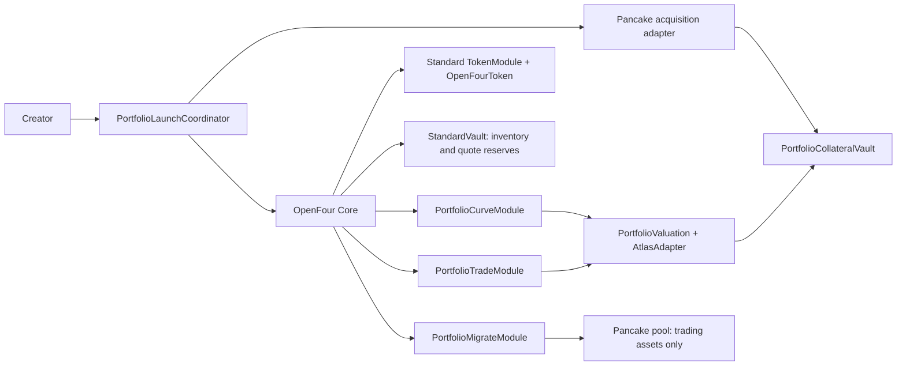

# IndexFi contracts — architecture decision draft

Target: Basket A, BSC Testnet 97. Local Hardhat tests use 31337.
The runnable foundation is `openfour/`, vendored from official startup at
`079a45e9c3358c9f357c84f336c7d915c9f0e9fc`. FairLaunch remains a reference
fixture; it is not the proposed portfolio preset.

## System boundaries

Creation-time PortfolioPresetValidator enforces consistency across these
components. Core and Registry implementations remain external protocol contracts.

## Selected components

| Component | Decision | Reason / boundary |
|---|---|---|
| OpenFourToken / StandardTokenModule | Reuse provisionally | Standard initializer mints maximum supply to market vault; creator allocation needs an explicit funding ledger before activation |
| StandardVault | Reuse for market accounting | Holds sale inventory and quote reserves, never constituent custody |
| PortfolioCollateralVault | Small custom contract | Immutable constituent set and quantities after activation, no creator withdrawals or rebalancing; ownership/end-of-life policy must be settled before implementation |
| PortfolioLaunchCoordinator | Custom | Atomically acquire assets, verify balance deltas, bind vault/token, validate initial supply ledger, seed separate quote reserves and activate |
| Acquisition adapter | Typed Pancake V3 calls | Exact-input routes, per-leg minimum outputs and deadline; allowlisted router/token/pool addresses, no arbitrary calldata execution |
| AtlasAdapter | Custom wrapper of official interfaces | Bind token identity to exact feed/network; positive price, units, future timestamp and freshness checks; normalize prices to 18 decimals |
| PortfolioValuation | Custom read-only calculation | Actual constituent balances and economic supply, excluding market reserves; explicit USD/USDC conversion |
| PortfolioCurveModule | Custom OpenFour curve | Forward and reverse quotes, conservative rounding and inventory bounds; fixed spread first, adaptive policy only after validated data inputs |
| PortfolioTradeModule | Custom OpenFour policy | Fail closed for invalid valuation; ordinary denials use allowed=false and encoded error; fees and size limits remain explicit |
| PortfolioMigrateModule | Custom wrapper/policy | Preserve constituent custody, recheck graduation, migrate market inventory/reserves only; destination and post-migration fee behavior need proof |
| CustomData | Defer | Add only if counters or risk checkpoints require post-trade state |
| PortfolioPresetValidator | Custom | Correct quote, collateral binding, supply partition, module versions, fee bounds and migration consistency |

No executable portfolio preset is registered yet. FairLaunch's stock migration
can burn leftover inventory and default LP ownership to the dead address; these
economics cannot be adopted without reconciling economic supply and LP rights.
Post-migration Pancake trades bypass the OpenFour Curve/Trade slots. Therefore
their Atlas guards and creator fees do not automatically persist on Pancake.

## Reference selection

| Reference | Adopt / study | Exclude / compatibility |
|---|---|---|
| OpenFour startup, pinned above | Exact interfaces, module schemas, validator and clone conventions, Token and market Vault | No copied Core/Registry/FeeRouter implementation; samples are unaudited |
| OpenZeppelin 4.9.6 | Direct locked dependency: SafeERC20, Math.mulDiv, ReentrancyGuard, access controls and initialization protection | Preserve starter version; do not mix OZ 5 storage/layout assumptions |
| Reserve Folio `e2d21a7df455aa2e0584e37703bc6e627ff2680c` | `contracts/Folio.sol`: totalAssets, _toAssets, balance/share rounding | MIT, exact compiler 0.8.28 conflicts with starter; inspiration only. Exclude continuous mint/redeem, auctions and fee-share minting |
| Index Protocol `1f5c9a0b3ef24c620f58b4fc38fe4c3809df9716` | BasicIssuanceModule: component units, required quantities, issue rounds up / redeem rounds down | Apache-2.0, Solidity 0.6.10; inspiration only. No later issuance/redemption engine in Basket A |
| Atlas push-oracle-interfaces | Official IMultiFeed / ISingleFeed ABI and timestamp units | Chain-97 feed deployment/permissions and exact collateral mapping still need evidence; mainnet read does not prove compatibility |
| PancakeSwap V3 | Deployed router/quoter interfaces for acquisition and exits | Nonzero pool liquidity alone does not prove executable size. USDC contract and routes remain unverified |
| PancakeSwap V2 / OpenFour PancakeV2MigrateLib | Existing startup migration mechanics as a test reference | Default burn/LP destinations and empty-pair requirement need product-specific checks |
| Ostium `8390ce497f68fb128900840e0ec30683afa945d3` | Secondary design reference for execution checks; no selected source dependency | No copied leverage, funding, liquidations, or assumed Atlas score/session fields |

Source links: [OpenFour](https://github.com/four-meme-community/openfour-docs),
[Folio](https://github.com/reserve-protocol/reserve-index-dtf/blob/e2d21a7df455aa2e0584e37703bc6e627ff2680c/contracts/Folio.sol),
[Index issuance](https://github.com/IndexCoop/index-protocol/blob/1f5c9a0b3ef24c620f58b4fc38fe4c3809df9716/contracts/protocol/modules/v1/BasicIssuanceModule.sol),
[Ostium](https://github.com/0xOstium/smart-contracts-public/tree/8390ce497f68fb128900840e0ec30683afa945d3).

## Economic and numerical invariants

- Funding F goes to constituent acquisition; separate reserve R is at least 1 USDC in verified quote base units. Account explicitly for fees and refunded swap dust.
- Initial supply S equals creator inventory plus sale inventory plus any migration inventory. The same units cannot be counted twice; burning changes the valuation denominator.
- Actual balances, not initial weights or frontend prices, determine reference value. Donations must have an explicit valuation policy.
- USD value = sum(balance * normalized USD price / token scale). Reference per share uses economic supply; convert through a valid settlement/USD price. Round buy cost up and sell payout down.
- Market sells consume quote reserves, never collateral. One USDC of initial liquidity does not guarantee exits at reference value.
- Every failed mandatory swap or initialization reverts the complete launch. Token transfers with unexpected balance deltas are rejected.
- Collateral balances survive buy/sell and migration; no privileged withdrawal or arbitrary external call path.
- Every quote revalidates timestamps and scales. Reject missing, zero, negative, future-dated or stale oracle observations.

## Implementation sequence and acceptance gates

1. Baseline: unchanged startup compiles and all 13 regression tests pass.
2. Economics: approve creator/sale/migration supply ledger, fees, collateral rights/end-of-life, LP ownership and post-migration policy. Resolve USDC quote eligibility.
3. Interfaces: pin asset registry version, Atlas feeds and DEX routes; define shared integer-unit vectors for TS/Python/Solidity.
4. Local collateral/coordinator: test partial failures, duplicates, decimal mismatches, transfer behavior, access controls and activation atomicity.
5. Oracle/curve/trade: test stale/future/invalid prices, forward/reverse rounding, reserve exhaustion, fees and wrong-token contexts.
6. Full local fork lifecycle: create, buy, sell, graduate and post-migration sell; reconcile collateral, market reserves, fees and LP ownership.
7. Authorized chain-97 deployment: developer-owned Registry only, deployment manifest and receipts. Defensive review and submit pack follow official workflow.

Current product decisions remain draft. No public deployment is necessary to
review this architecture or run the baseline. The present skill phases are
scope/environment initialization; portfolio module development and later phases
remain pending.
